# J.A.R.V.I.S. — assistente de voz em Java

Assistente pessoal de voz feito do zero em **Java + JavaFX**, inspirado no Jarvis dos filmes.
Ele ouve o que você fala, entende o pedido com IA e **executa ações de verdade no computador**: abre programas, pesquisa na web, toca música, controla o volume, guarda lembretes e responde por voz.



> 🎥 Vídeo dele funcionando: [LinkedIn](#) <!-- troque pelo link do post -->

---

## O que ele faz

| Comando de voz (exemplo) | O que acontece |
| --- | --- |
| "Bom dia, Jarvis" | Conversa e responde em voz alta |
| "Abre o VS Code" | Abre o aplicativo no Windows (`abrir_aplicativo`) |
| "Toca uma música no Spotify" | Busca e toca no Spotify (`tocar_musica_spotify`) |
| "Aumenta o volume" | Controla o volume do sistema (`controlar_volume`) |
| "Pesquisa o preço de..." | Abre o navegador, lê a página e resume (`abrir_pagina`, `extrair_texto_pagina`) |
| "Me lembra de estudar às 21h" | Salva uma anotação/lembrete (`salvar_nota`) |
| "Lembra que eu gosto de..." | Guarda memória de longo prazo sobre o usuário (`lembrar_sobre_mim`) |
| "Liga a câmera" | Mostra a webcam dentro do portal holográfico (`controlar_webcam`) |
| "Desativar reconhecimento de voz" | Liga/desliga a escuta automática (`controlar_escuta_automatica`) |

Além das ferramentas, ele tem **skills**: arquivos `.md` na pasta [`skills/`](skills) com o passo a passo de tarefas que se repetem (resumir vídeo do YouTube, traduzir texto, pesquisar notícias...). A IA lista as skills e só lê a que for útil, pra economizar contexto.

## Como funciona

```
 Microfone ──► Vosk (reconhecimento de voz offline)
                 │
                 ▼
          VoiceCorrections  (corrige nomes que o modelo ouve errado)
                 │
                 ▼
            JarvisAgent ◄──► API de IA (tool use)
                 │  a IA decide qual ferramenta usar
                 ▼
   AppTool · BrowserTool · SpotifyTool · VolumeTool · NotesTool
   MemoryTool · SkillManager · WebcamTool
                 │
                 ▼
     Resposta ──► Piper TTS (voz offline pt-BR) + interface JavaFX
```

- **`JarvisAgent`**: o núcleo. Mantém a conversa, chama a API e executa as ferramentas Java que a IA pedir, em loop, até ela terminar a resposta.
- **`JarvisFxApp`**: a interface holográfica em JavaFX (núcleo animado que muda de cor ao ouvir/pensar/falar, chat e painéis).
- **`Main`**: modo texto, no terminal, usando o mesmo núcleo.
- **`AudioTool`**: entrada de voz com **Vosk** e saída com **Piper**, os dois rodando localmente, sem nuvem.
- **`VoiceCorrections`**: o modelo de voz pequeno erra muito em nomes estrangeiros ("abri vê-se com luzes" → "abre o VS Code"). Essa classe corrige por distância de edição contra uma lista de termos conhecidos.

## Tecnologias

- Java 17 · JavaFX 21 · Maven
- Jackson (JSON) · `java.net.http.HttpClient`
- Vosk (speech-to-text offline) · Piper (text-to-speech offline)
- Selenium + WebDriverManager (navegador)
- OpenCV (webcam)
- API da Anthropic (tool use)

## Como rodar

> Hoje o projeto roda no **Windows** (usa `piper.exe`, o comando `start` e PowerShell para o volume).

1. **Pré-requisitos:** JDK 17+ e Maven.
2. **Chave da API:** defina a variável de ambiente `ANTHROPIC_API_KEY`.
   - Opcional, para o Spotify: `SPOTIFY_CLIENT_ID` e `SPOTIFY_CLIENT_SECRET`.
3. **Modelo de voz (entrada):** baixe um modelo em português do [Vosk](https://alphacephei.com/vosk/models) e extraia na pasta `vosk-model/`, na raiz do projeto.
4. **Voz do Jarvis (saída):** baixe o [Piper](https://github.com/rhasspy/piper/releases) para Windows e extraia em `piper/`. Coloque a voz em `piper/voices/pt-BR-razo-medium.onnx` (com o `.onnx.json` junto).
5. **Memória (opcional):** copie `memoria.exemplo.txt` para `memoria.txt` e edite como quiser.
6. **Compilar e rodar:**

```bash
mvn clean package
java -jar target/jarvis-core-1.0-SNAPSHOT.jar
```

Ou rode a classe `com.jarvis.JarvisFxLauncher` direto pelo IntelliJ.

## Estrutura

```
src/main/java/com/jarvis/   código-fonte (núcleo, interface e ferramentas)
src/main/resources/         estilo da interface (jarvis.css)
skills/                     instruções em .md para tarefas recorrentes
docs/                       imagens do README
```

## Desafios que enfrentei

- **Vazamento de memória nativa:** o reconhecimento de voz contínuo ia acumulando memória fora da JVM até travar o programa. Precisei investigar e garantir que os recursos de áudio e do modelo fossem liberados corretamente.
- **Reconhecimento de nomes técnicos:** o modelo de voz pequeno não conhece palavras como "VS Code" ou "Steam". Resolvi com uma camada de correção por aproximação (`VoiceCorrections`).
- **Interface e IA ao mesmo tempo:** as chamadas à API e o áudio rodam fora da thread do JavaFX para a interface não congelar.

## Próximos passos

- [ ] Suporte a Linux/macOS
- [ ] Testes unitários das ferramentas (JUnit)
- [ ] Mais skills

---

Feito por **Junior Reis**, estudante de Ciência da Computação, como projeto de estudo de Java.
